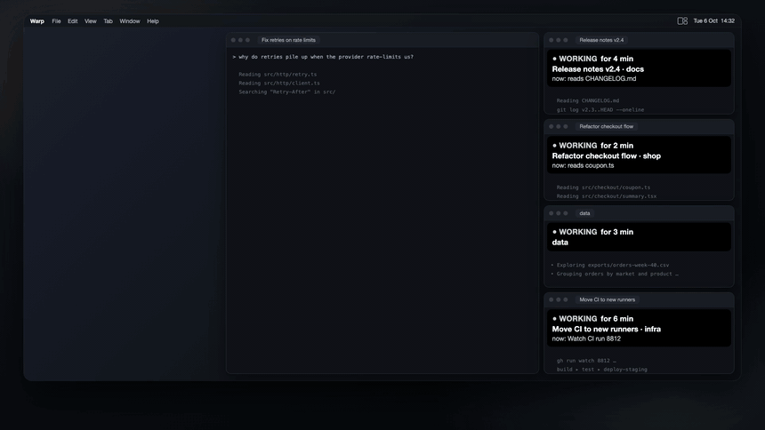
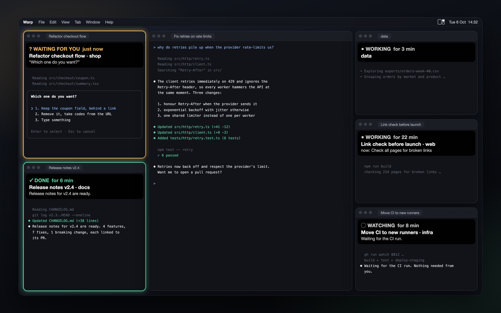

# Lookout

I run a lot of AI sessions in the terminal at the same time, and I kept losing track of them. Which one is
done? Which one has been waiting for my answer for a while? So my AI agents built me Lookout, a small Mac app
for exactly that.

It sits in the menu bar, lines up the terminal windows of your Claude Code, Codex, Grok and Kimi sessions in
Warp or Ghostty, and shows which session is working, which one is done and which one is waiting for you.



*Animation with demo sessions. It follows Lookout's real rules, just faster.*

## What it does



- **Frames:** when a session is done, its window gets a soft mint frame. When it can't go on without you,
  because it needs your approval or wants you to pick an answer in a question box, the frame is amber. If the AI
  only asks something at the end of its answer, that counts as done; the label then shows the first sentence of
  the answer, so open the window to see the question.
  The window you're working in never gets a frame; you're looking at it anyway.
- **Labels:** every other AI window gets a small dark label with the status and how long it has been in it, the
  session name and, for Claude Code, the current step or the first sentence of the answer or question. You see
  it without clicking into the window. For Codex, Grok and Kimi the label is shorter: status, time and window
  title.
- **Four states:** `? WAITING FOR YOU`, `✓ DONE`, `● WORKING` and `◌ WATCHING` (Claude Code only, see below).
- **Layouts:** three layouts for all AI windows on one screen, switched with Ctrl+Opt+1, 2 and 3.
  - **Focus:** the window you click goes to the middle. The others line up by who needs you first: waiting, then
    done (first come, first served), then working.
  - **Focus 2:** the middle stays yours, waiting and done windows on the left, working ones on the right. On
    screens narrower than about 2360 points (every MacBook) only one strip fits (on the right by default): it
    holds the waiting and done windows, and the working sessions become rows in a list there.
  - **Grid:** every window gets a fixed place (2 × 2 up to 5 × 2, only the sizes that fit). Nothing moves when a
    status changes, and a click doesn't change the order.
- **Control room:** with two or more screens, your active session and the windows that need you are on one
  screen, the busy ones on the other. There are three variants in the menu. The layout is fixed there, so the
  hotkeys don't apply.
- **Windows that come to you:** in Focus, Focus 2 and the control room, a window glides to the front of the
  line as soon as its session is done or needs you, and back once it works again. In the Grid every window keeps
  its place.
- **Windows stay where Lookout puts them:** if you drag an arranged window somewhere else, Lookout moves it back
  within a few seconds. To keep a window where you put it, take it out under *More > Choose windows*, or use
  *More > Pause (move nothing)*.
- **Screens:** every connected display shows up in the menu under the name macOS gives it ("All on DELL
  U2723QE", "All on the MacBook"; two identical monitors get (1) and (2) from the left). Lookout remembers the
  display you chose. While it's unplugged, the windows go to your biggest remaining screen, and they come back
  when you plug it in again. With three or more screens, *Control room screens* lets you pick which one holds your
  active session and which one shows the busy ones.
- **Lists at the side:** in Focus and Focus 2, when a side is full, the extra sessions show up as rows in a list
  at the bottom of that side. Their windows wait behind the center window; a click on a row brings that window
  to the center. The lists only show while labels are on.
- **Menu bar:** the icon's top right tile fills as soon as a session is done or waiting (the window you're working
  in counts too). No numbers, nothing blinking. The menu lists your sessions by status; a click brings that window
  to the front and makes it the active one. Hover over a screen or layout in the menu to see where your windows
  would go before anything moves.
- **"Watching":** some Claude Code sessions are done but only wait for their own background job (a CI run,
  workers), for another session, or for a timer they set themselves. They turn grey instead of "done": they don't
  need you, so they don't ask for your attention. Details and limits below.

Lookout only moves windows with a recognized AI session. Normal terminal windows, minimized and full screen
windows, and windows you took out stay where they are.

## How it was built

I don't write code by hand. Lookout was written by AI agents: Claude Code built it, Codex, GLM and Kimi
reviewed it in rounds, and I used it every day and said what had to change until it felt right. The
"watching" rules were tuned on 1,204 real cases from my own sessions. I work in German, so the code comments
and the log file are in German too.

## Requirements

- macOS 26 or later (I use it on macOS 27)
- [Warp](https://www.warp.dev) (the stable version, not Warp Preview) or [Ghostty](https://ghostty.org). I use
  Warp every day; Ghostty works too, but it got less real use.
- Claude Code (tested with 2.1.295) and/or the Codex, Grok or Kimi command line tools
- Xcode Command Line Tools (`xcode-select --install`), for `swiftc`

Lookout reads Claude Code's status from its files. For background agents and as a fallback it also runs
`claude agents`, and it looks for `claude` in `~/.local/bin`, `/opt/homebrew/bin` and `/usr/local/bin`. If yours
lives elsewhere (nvm, for example), add a symlink: `ln -s "$(which claude)" ~/.local/bin/claude`.

## Install

```sh
git clone https://github.com/kevintheo-ai/lookout.git
cd lookout
./build.sh
open ~/Applications/Lookout.app
```

On first start macOS asks for **Accessibility** access (System Settings > Privacy & Security >
Accessibility > Lookout). Lookout needs it to read and move terminal windows; nothing else. Right after that it
lines up your AI windows in Focus on your biggest external screen (or on the Mac's own screen if there is no
other). You can pick another screen or layout in the menu.

To start Lookout at login: System Settings > General > Login Items > add Lookout.

`./build.sh --tests` builds and runs the tests (116 right now). If you have Xcode.app installed and `swiftc`
complains about the license, run `sudo xcodebuild -license accept` once.

**Keep the Accessibility access across rebuilds (optional):** `build.sh` signs ad hoc if you have no code
signing identity, and macOS then asks for access again after every rebuild. To avoid that, create a
self-signed certificate (Keychain Access > Certificate Assistant > Create a Certificate…, Certificate Type:
Code Signing), check that `security find-identity -v -p codesigning` lists it, and build once with
`LOOKOUT_SIGN_ID="<certificate name>" ./build.sh`. Later builds reuse the identity of the installed app.

`build.sh` also understands `LOOKOUT_APP_DIR` (default `~/Applications`) and `LOOKOUT_BUNDLE_ID`
(default: the installed app's, else `io.github.kevintheo-ai.lookout`). It builds for the CPU of your Mac.

## Update and uninstall

- **Update:** `git pull && ./build.sh`, then quit Lookout from its menu and open it again.
- **Uninstall:** quit Lookout, delete `~/Applications/Lookout.app`, remove it from Accessibility and Login
  Items. Optional leftovers: `~/.config/lookout.json`, `~/Library/Logs/Lookout.log*` and the preferences
  (`defaults delete io.github.kevintheo-ai.lookout`).

## Settings

Everything works without a settings file. To change something, create `~/.config/lookout.json` and restart
Lookout (it reads the file once at start), for example:

```json
{ "language": "en", "claudeConfigDirs": ["~/.claude", "~/.claude-work"], "glowColor": "#5ECFA0" }
```

| Key | Default | Meaning |
|---|---|---|
| `language` | your Mac's language | `"de"` or `"en"` (German or English menus and labels) |
| `claudeConfigDirs` | `["~/.claude"]` | Claude Code configuration folders to watch, one per `CLAUDE_CONFIG_DIR` you use |
| `layout` | `"reading"` | layout until you choose one in the menu: `reading` (Focus), `focus2`, `grid` |
| `stackSide` | `"right"` | side of the window column (the "strip" in the menu) when only one fits next to the center: `right`, `left` |
| `readyThresholdSec` | `90` | seconds of quiet before a background command counts as resting, and the fallback for tools that don't say when their answer ends |
| `pollSec` | `3` | how often windows are checked (seconds) |
| `sessionPollSec` | `6` | how often session status is read (seconds) |
| `hotkeys` | `true` | Ctrl+Opt+1 … 3 for Focus, Focus 2 and the last grid |
| `glow` | `true` | colored frames around windows that are done or waiting |
| `glowColor` | `"#5ECFA0"` | frame color for "done" (mint) |
| `glowColorWaiting` | `"#E8B25C"` | frame color for "waiting for you" (amber) |
| `labels` | `true` | whether labels show at first start; after that, your choice in the menu is used |
| `leadNames` | `[]` | own names (`claude --name …` or `/rename`) of sessions that lead other sessions, written exactly the same; an automatic topic title does not count (see "Watching" below) |

The menu remembers your choice of screen, layout, grid, control room screens, excluded windows and labels.
Pause and the side of the strip (*More > Strip on the right/left*) start fresh after a restart.

## What Lookout does on your Mac

I want you to know exactly what it touches:

- It **moves AI terminal windows** as soon as it has Accessibility access. *More > Pause (move nothing)* stops
  all moving until you turn it off or quit Lookout. Frames and labels keep updating.
- To learn which window belongs to which session, it briefly writes a marker into the session's **tab title**
  and then puts the title back. You may see a title flash. A tab in the background can't be read, so it gets its
  folder name as title instead. For sessions it couldn't match yet, Lookout tries again every 2 minutes.
- It reads the **status files and the end of the transcripts** that Claude Code keeps in its configuration
  folder, and the session logs of Codex (`~/.codex`), Grok (`~/.grok`) and Kimi (`~/.kimi-code`). It runs
  `claude agents` every 5 minutes, and more often if the status files are missing.
- Some sessions **start with a prompt you didn't type** (for example a handover from another session). To tell
  these apart from your own messages, it reads the start arguments of that Claude process.
- It opens **no network connection** itself. It runs local tools only: `ps` (every 3 seconds), `nettop` and
  `lsof` (only while a Claude session has finished its answer but still runs background commands), and `claude`.
- It writes a log to `~/Library/Logs/Lookout.log` (in German; rotated at 5 MB, one old file kept). The log
  contains session names, status changes and the titles of terminal windows you click, but no answer text.
- The **labels show transcript text** (answers, questions), and so does the open menu. Before you share your
  screen, turn the labels off (*More > Show labels*) and keep the menu closed.

## "Watching" in detail

Lookout is strict here: a grey session that actually needed your answer is worse than one "done" too many. So
a Claude Code session shows grey **WATCHING** instead of **DONE** only when its answer is done and

- Claude Code reports that only background commands are left (status `shell`), a background command of the
  session rests (no real CPU or network use for 90 seconds) and is not a server (a server listens on a port; a
  resting server alone means "done"), or
- it only waits for another running Claude session that talks to it, or for a timer it set itself, and its
  last answer says explicitly that nothing is needed from you,

and the answer contains no question, no request to you, no earlier question still open ("my question above
stands", "still open with you") and no "finished" message, and the turn was not started by your own message
(with the exceptions below).

A few details:

- "Done" about a part ("part 1 is done"), negated ("not finished"), still to come ("when the run is done") or
  as a "Done:" heading next to "Still to do:" is not a "finished" message.
- With a resting background command it is enough that the first sentence says explicitly that nothing is
  needed from you and the answer contains no question; what follows may report on other windows.
- If your own message started the turn, a resting background command still means "watching" when its last
  sentence is a promise to report back ("I'll report back when …", "I'll let you know") and the answer
  contains no question, no request or condition for you ("please", "if you") and no "finished" message.
- With a resting background command, once you have had the session's tab in front after the answer (clicked
  it, or terminal in front with that tab while Lookout checked, screen unlocked), your message no longer
  counts: the answer is judged as if the session had started the turn itself.
- For a session that waits for another session or a timer, the same applies once you have seen the answer,
  but the answer still has to say explicitly that nothing is needed from you; your message does not end its
  conversation with the other session.
- A prompt the session was started with (`claude "…"`, for example a handover from another session) does not
  count as your message, even if you started it that way yourself.
- A session named in `leadNames` (one that runs other sessions and reports on their windows) with a resting
  background command that is not a server turns "done" only when its answer contains a "?" or your own unseen
  message started the turn.
  Its reports ("two windows wait for you", "the handover is complete") are about other windows, not this one.

When in doubt, Lookout shows "done". Still, on my 1,204 test cases a few sessions that asked for something turned
grey, so it's not perfect.

## Limits

- Status files and transcript entries are **internal formats of Claude Code**. If the status files change,
  Lookout falls back to `claude agents`, which means one extra query at every status check. If the transcript
  entries change, "watching" no longer appears and labels lose the step and the answer. Older Claude Code versions
  that report background commands as `busy` instead of `shell` show such sessions as working.
- Codex, Grok and Kimi get less: no "watching", no step or answer on the label, and the session name is the
  folder name. A new Codex, Grok or Kimi session shows up after its first turn. Lookout reads their logs only
  in the default folders. I have seen "waiting for an approval" in real use with Grok. For Codex and Kimi I
  haven't seen it yet; Lookout recognizes it by the event name in their logs.
- The word list behind "watching" knows English and German only. In other languages a session with a resting
  background command can turn grey even if its answer asks you for something, as long as there is no "?".
- Only **Warp and Ghostty** windows are arranged. Sessions in other terminals (VS Code, iTerm, Terminal)
  are listed under *More > Without window*. Sessions inside `tmux` are not matched to a window.
- With Warp and Ghostty at the same time, a Ghostty window parked behind a Warp center window can end up in
  front of it (Lookout can only raise windows within one app).
- On narrow screens (a 13-inch MacBook Air, a monitor in portrait mode) the center in Focus gets narrow
  (about 500 points); Focus 2 keeps it wide.
- Identical monitors that report no serial number look the same to macOS; Lookout tells them apart only by their
  order from the left. After you unplug or plug in one of them, your choice can move to its neighbor; one click in
  the menu sets it again.

## Kurz auf Deutsch

Lookout ist eine kleine Menüleisten-App, die ich mir für meinen eigenen Schreibtisch habe bauen lassen: Sie ordnet
die Terminalfenster deiner KI-Sessions (Claude Code, Codex, Grok, Kimi in Warp oder Ghostty) und zeigt ruhig, wer
arbeitet, wer fertig ist und wer auf dich wartet. Fertig ist mintgrün umrahmt, bernsteinfarben heisst: die Session
braucht deine Freigabe oder deine Auswahl in einem Fragefenster. Installation wie oben (`git clone`, `./build.sh`,
Bedienungshilfen freigeben). Die Sprache folgt dem Mac; fest auf Deutsch mit `{"language": "de"}` in
`~/.config/lookout.json`. Die Schilder zeigen Text aus deinen Sessions: vor dem Bildschirmteilen unter
*Mehr > Schilder anzeigen* ausschalten.

## License

MIT, see [LICENSE](LICENSE). Lookout is an independent project and not affiliated with Anthropic, OpenAI,
xAI, Moonshot AI, Warp or Ghostty. All product names are trademarks of their respective owners.
